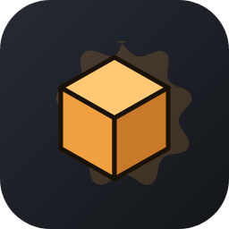
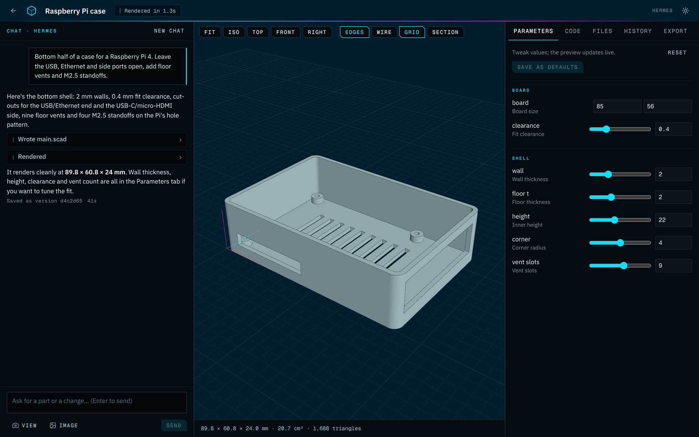
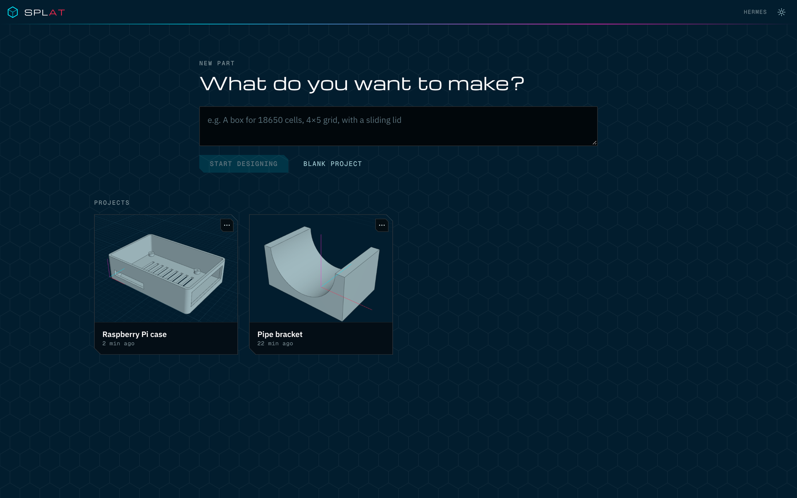
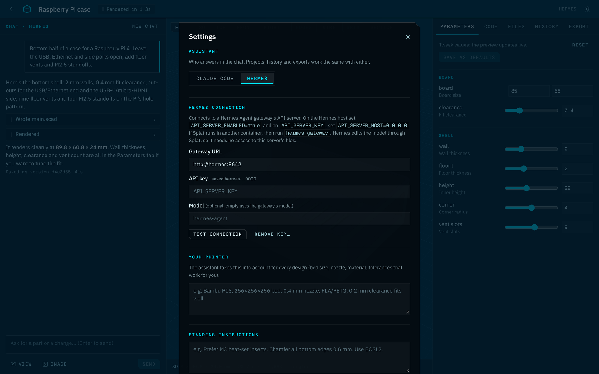

<p align="center"></p>

# Splat

Design 3D-printable parts by chatting with an AI. Splat is a self-hosted web app in one Docker container. Describe a part and Claude Code (or [Hermes Agent](https://hermes-agent.nousresearch.com/)) writes parametric OpenSCAD for it, while a live 3D preview updates next to the chat.



## Features

- **Chat to model.** Describe a part, attach a sketch or a picture of the current view, ask for changes. The assistant renders its own work and fixes errors before it answers.
- **Live preview.** Every change re-renders automatically. Orbit, standard views, edges, wireframe, section cut, size and volume.
- **Parameters.** Sliders generated from the code (`wall = 2; // [0.8:0.2:5]`). Tweak, then save as the new defaults.
- **Code editor** with OpenSCAD highlighting, autosave and Ctrl+S to save a version.
- **Version history.** Each project is a git repository. Every chat turn, edit and import is a version you can preview, diff and restore.
- **Import** STL, 3MF, OBJ, PLY, glTF, STEP, SVG, DXF, PNG heightmaps, fonts and .scad files by dropping them on the workspace.
- **Export** 3MF, STL, STEP, OBJ, glTF/GLB, PLY, OFF, AMF, SVG, DXF, PDF, PNG and a zip of the source, plus an "Open in OrcaSlicer" link.
- **Libraries.** BOSL2 and MCAD are built in. Add your own in `appdata/splat/libraries`.



## Install on Unraid

1. In the Unraid terminal, download the template:

   ```sh
   wget -O /boot/config/plugins/dockerMan/templates-user/my-Splat.xml \
     https://raw.githubusercontent.com/thomas-nelson23/splat/main/unraid/splat.xml
   ```

2. Docker tab → **Add Container** → pick **Splat**.
3. Set an **App password** (recommended if it's reachable from the internet), optionally a Claude token or API key, and click **Apply**.
4. Open the web UI from the container's icon.

Every push to `main` publishes `ghcr.io/thomas-nelson23/splat:latest`, so updates show up on the Docker tab as usual. Tags like `v1.2.3` also publish `:1.2.3` and `:1.2`.

Elsewhere, run the image with a volume on `/data` and port 8080:

```sh
docker run -d -p 8080:8080 -v ./splat-data:/data -e APP_PASSWORD=change-me ghcr.io/thomas-nelson23/splat:latest
```

## Choosing the assistant



**Claude Code** (default). In Settings, paste either a subscription token (run `claude setup-token` on any computer with Claude Code, uses your Pro/Max plan) or an Anthropic API key (pay per use). Claude runs with full permissions inside the container only, which is why an app password is a good idea.

**Hermes Agent.** Pick Hermes in Settings and enter the gateway URL and key. On the Hermes host, enable its API server in `~/.hermes/.env` and run `hermes gateway` (port 8642):

```sh
API_SERVER_ENABLED=true
API_SERVER_KEY=<a long random string>   # the same value goes into Splat
API_SERVER_HOST=0.0.0.0                 # if Splat reaches it over the Docker network
```

Hermes never touches Splat's files. Splat sends the project sources with each message, Hermes replies with whole files, and Splat writes, renders and versions them, sending render errors back for up to three fix attempts. Unlike Claude Code, Hermes doesn't see snapshots of the model.

## Configuration

Settings in the app take priority over these container variables.

| Variable | Default | |
|---|---|---|
| `APP_PASSWORD` | none | Password for the web UI |
| `CLAUDE_CODE_OAUTH_TOKEN` | | Subscription token from `claude setup-token` |
| `ANTHROPIC_API_KEY` | | Anthropic API key |
| `CLAUDE_MODEL` | Claude Code default | e.g. `opus`, `sonnet` |
| `SPLAT_AGENT` | `claude` | `hermes` to use Hermes Agent |
| `HERMES_URL` | | e.g. `http://hermes:8642` |
| `HERMES_API_KEY` | | The gateway's `API_SERVER_KEY` |
| `HERMES_MODEL` | gateway default | Optional model override |
| `RENDER_TIMEOUT_SECONDS` | 600 | Max time for one render |
| `PUID` / `PGID` | 99 / 100 | Owner of files in `/data` |
| `PORT` | 8080 | |

Everything lives in `/data`: one git repository per project under `projects/`, deleted projects in `projects/.trash/`, your libraries in `libraries/`, and `settings.json` (credentials stored with 0600 permissions).

**OrcaSlicer:** download the 3MF and open it, or use **Open in OrcaSlicer**, which only works when OrcaSlicer's computer can reach the server directly (for example on your LAN).

## Development

```sh
npm install
DATA_DIR=./data npm run dev:server   # API on :8080 (needs openscad, git, python3 with trimesh + cadquery-ocp)
npm run dev:web                      # Vite on :5173, proxies to :8080
```

Node 22, Express and WebSockets (TypeScript) on the server; React, three.js and CodeMirror in the browser; the Claude Agent SDK or a Hermes gateway for chat; OpenSCAD for rendering; Python (OCP, trimesh) for STEP and mesh conversion. The UI uses the Steeze design system, vendored in `web/src/steeze/`.
